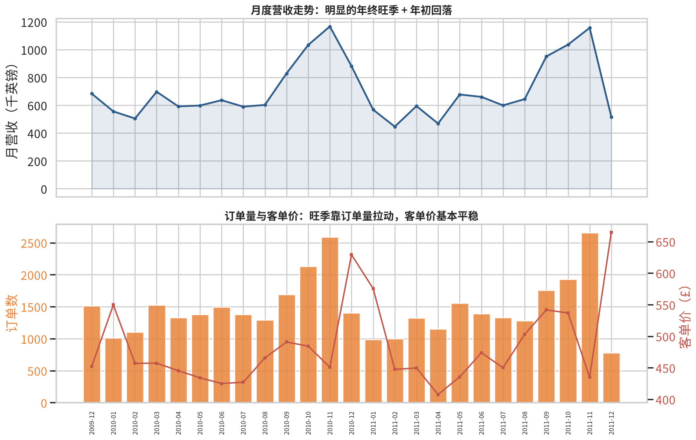
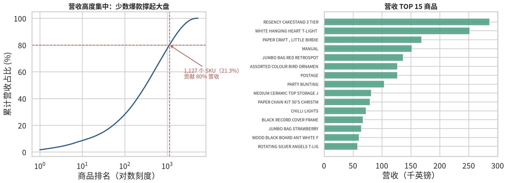
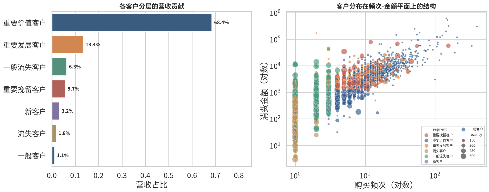
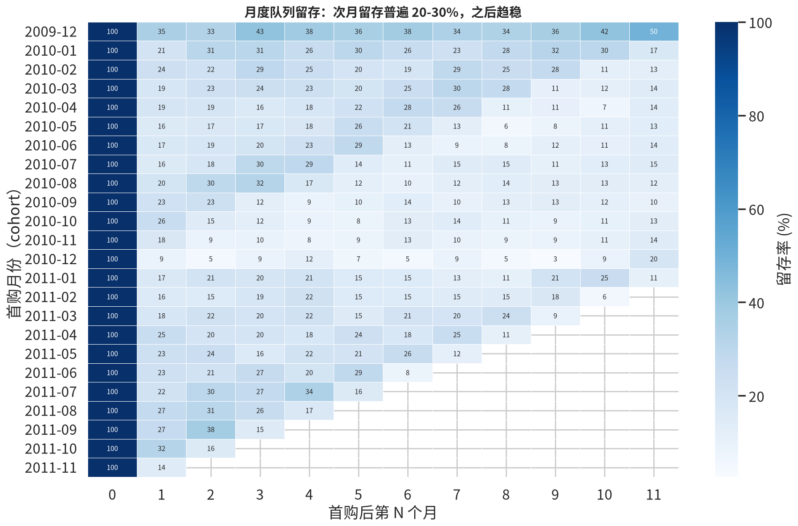
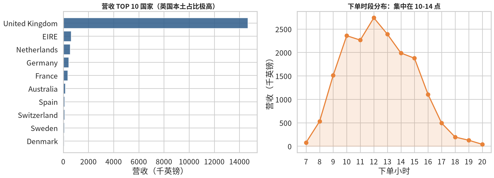
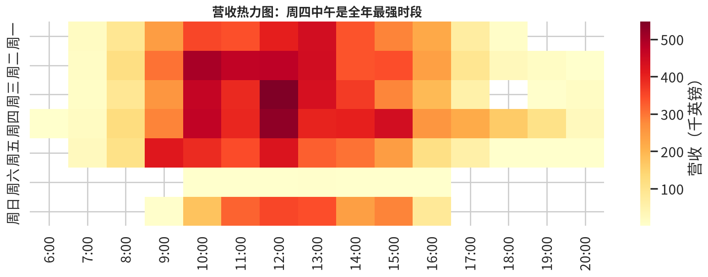

# 电商交易数据分析报告

**数据集**：UCI Online Retail II（英国在线礼品零售商，2009-12 ~ 2011-12）
**分析范围**：清洗后 793,609 条有效交易 · 36,969 笔订单 · 5,878 名客户 · 4,631 个 SKU · 营收总额 £17,685,461

> 注：2011-12 数据只到 12 月 9 日，同比解读时已考虑该截止日影响。

---

## 一、数据质量与清洗过程

原始数据 1,067,371 行，清洗后保留 793,609 行（74.4%）。清洗全程留痕：

| 清洗步骤 | 剔除行数 | 业务含义 |
|---|---:|---|
| 完全重复行 | 12,133 | 同一订单同一商品重复录入 |
| 取消订单（C 开头） | 19,433 | 退款单，不计入销售收入 |
| 数量 ≤ 0 | 3,457 | 退货、库存调整 |
| 单价 ≤ 0 | 2,739 | 赠品、坏账调整 |
| 缺失 Customer ID | 236,000 | 无法归因到具体客户 |

**关键决策**：缺失 Customer ID 的记录占 22.1%，是最大的一块剔除。这些多为柜台散单，无法做用户层分析（RFM/留存），做销售大盘时可以保留，但本项目的核心是用户经营，因此统一剔除并在报告中注明口径。

极端大额订单（3×IQR 以上）只打标不删除，做了剔除前后的敏感性对比：全量营收 £17.69M，剔除极端值后 £10.03M，说明营收受少数大客户影响显著——这本身就是重要发现（见第三节）。

---

## 二、Q1 大盘：增长靠旺季，2011 年下半年现疲态

- **强季节性**：每年 9 月起营收爬坡，11 月达到峰值（2010-11：£1.17M；2011-11：£1.16M），次年 2 月触底（£0.45M），峰谷比约 2.6 倍。这是典型的礼品零售节奏（圣诞备货季）。
- **旺季由订单量驱动**：旺季订单数翻倍（月均 ~1,300 → ~2,600），而客单价全年稳定在 £420-550 区间，说明旺季是「更多人买」，不是「买得更贵」。
- **同比隐忧**：2011 年 2-4 月连续三个月同比下滑（-11.6% / -14.8% / -20.9%），9 月虽因旺季回升（+14.7%），但 10-11 月已与去年持平。整体看 2011 年增长乏力，12 月（截至 9 日）同比 -41.3% 需警惕但部分为数据截止所致。

**业务含义**：备货、人力、营销预算应按 9-11 月旺季节奏提前 1-2 个月布局；2011 年的增长停滞需要拆解是新客获取问题还是老客流失问题（见 Q3/Q4）。

---

## 三、Q2 商品：少数爆款撑起大盘

- **2/8 法则的更极端版本**：4,631 个 SKU 中，仅 1,127 个（21.3%）贡献 80% 营收。
- 营收 TOP 3 商品：REGENCY CAKESTAND 3 TIER（£17.5 万）、WHITE HANGING HEART T-LIGHT HOLDER（£27 万量级的头部商品集群）、PAPER CRAFT, LITTLE BIRDIE。
- 头部商品多为**低价高频的家居装饰/节日用品**，单价多在 £1-5 之间，靠走量取胜。

**业务含义**：
1. 爆款 SKU 缺货的直接损失远高于普通商品，应给予最高库存优先级；
2. 长尾 SKU（营收后 50% 仅贡献约 3%）可考虑精简，降低库存资金占用；
3. TOP 商品与节日强相关（圣诞灯饰、装饰球），可与 Q1 的季节性联动做选品。

---

## 四、Q3 客户：二八法则在客户侧同样成立

RFM 五分位打分（R=最近购买间隔、F=频次、M=金额），7 类分层结果：

| 客户分层 | 人数 | 人数占比 | 营收占比 | 人均消费 |
|---|---:|---:|---:|---:|
| 重要价值客户（R高F高M高） | 1,299 | 22.1% | **68.4%** | £9,311 |
| 重要发展客户（近期高消费但频次低） | 655 | 11.1% | 13.4% | £3,626 |
| 一般流失客户 | 1,260 | 21.4% | 6.3% | £887 |
| 重要挽留客户（曾高价值、近期未购） | 226 | 3.8% | 5.7% | £4,487 |
| 新客户 | 926 | 15.8% | 3.2% | £606 |
| 流失客户 | 1,273 | 21.7% | 1.8% | £255 |
| 一般客户 | 239 | 4.1% | 1.1% | £833 |

**核心发现**：
1. **22% 的客户贡献 68% 的营收**；SQL 独立验证：消费 TOP 5% 客户贡献 52.1% 营收。
2. **重要挽留客户值得单独关注**：仅 226 人（3.8%）却贡献 5.7% 营收，人均 £4,487——这批「曾经的优质客户正在离开」，是挽回 ROI 最高的群体。
3. 新客户人均消费仅 £606，且 Q4 显示留存差，说明**新客承接有问题**：拉新之后没有转化出第二个高价值客户。

---

## 五、Q4 留存与复购：总量好看，质量堪忧

- 整体复购率 72.4%（4,255 / 5,878 客户有 ≥2 次订单）——因为观察窗口长达 25 个月，B2B 客户占比高，这个数字「看起来健康」。
- 但**队列视角揭示真相**：各月新客的次月留存率中位数仅 20.5%（四分位区间 17.3%~24.2%），即每拉来 10 个新客，下个月只剩 2 个还会买。
- 留存曲线在 3 期后趋平（约 10-15%），呈「间隔性回流」特征，平均复购间隔 51.7 天。说明客户没有真正流失，而是低频采购——适合用**回购提醒/补货召回**而非单纯拉新。
- 2009-12 队列（最早一批客户）第 11 期留存仍有 50%，证明**早期获客质量显著更高**，2010 年中之后的队列留存明显走低。

**业务含义**：
1. 次月留存 20% 是最大杠杆点：若提升到 30%，按当前新客规模一年可多贡献约 £50-80 万营收（按新客人均 £606 估算）；
2. 针对平均 51.7 天的复购间隔，可在第 35-40 天设计召回触点（邮件/券）；
3. 复查 2010 年后获客渠道质量是否下降（数据集无渠道字段，作为后续可研究方向）。

---

## 六、Q5 区域与时段：本土依赖 + 清晰的运营时钟

- **英国本土占 82.9%**，第二至第五大市场为爱尔兰（3.5%）、荷兰（3.1%）、德国（2.4%）、法国（2.0%）。海外欧洲市场合计约 11%，是最现实的增长方向（物流近、文化近）。
- **下单时段**：工作日 10:00-15:00 为高峰，峰值在周四 12:00 前后；**周六几乎零交易**——典型 B2B 特征（企业采购者工作日下单），也解释了客单价高（£478）和批量购买行为。

**业务含义**：
1. 客服/投放预算按工作日白天配置，周末无需值守；
2. 营销活动发券时间设在周二、周三上午，赶上下单高峰；
3. 海外增长优先做荷兰、德国（营收高且订单转化稳定），其次法语区。

---

## 七、结论与行动建议

| # | 发现 | 建议 | 预期影响 |
|---|---|---|---|
| 1 | 次月留存仅 20.5% | 搭建 35-40 天复购召回流程（契合 51.7 天平均间隔） | 留存每 +5pct，年营收约 +£15-25 万 |
| 2 | 226 名重要挽留客户人均 £4,487 | 定向挽回（专属券 + 客户经理回访） | 挽回 20% 即回收 £20 万/年 |
| 3 | 21.3% SKU 贡献 80% 营收 | 爆款保供 + 清理长尾，降低库存占用 | 释放库存资金、减少缺货损失 |
| 4 | 9-11 月旺季、11 月峰值 | 8 月底前完成旺季备货与营销排期 | 吃满 2.6 倍峰谷弹性 |
| 5 | 海外仅占 17% | 优先拓展荷兰/德国/爱尔兰 | 分散单一市场风险 |
| 6 | 2011 年增长停滞 | 拆解新客获取 vs 老客流失，补渠道数据 | 定位增长瓶颈 |

**后续可扩展方向**（写进简历的加分项）：
- 引入客户生命周期价值（CLV）模型（如 BG/NBD + Gamma-Gamma，`lifetimes` 库）
- 构建销量预测（Prophet / LightGBM）支撑旺季备货
- 用 Streamlit 搭建交互式经营看板
- A/B 测试设计：召回邮件对 35 天未购客户的效果验证

---

## 附：分析方法与工具

- **清洗**：pandas，全程留痕（`cleaning_log.csv`）
- **分析**：pandas + SQLite 双引擎，结果互相验证（差异为 0）
- **SQL 能力**：窗口函数（`NTILE` 百分位、`LAG` 计算复购间隔）、CTE 多级嵌套
- **可视化**：matplotlib + seaborn（帕累托图、队列留存热力图、RFM 散点、时段热力图）
- **数据**：UCI Online Retail II，CC BY 4.0
